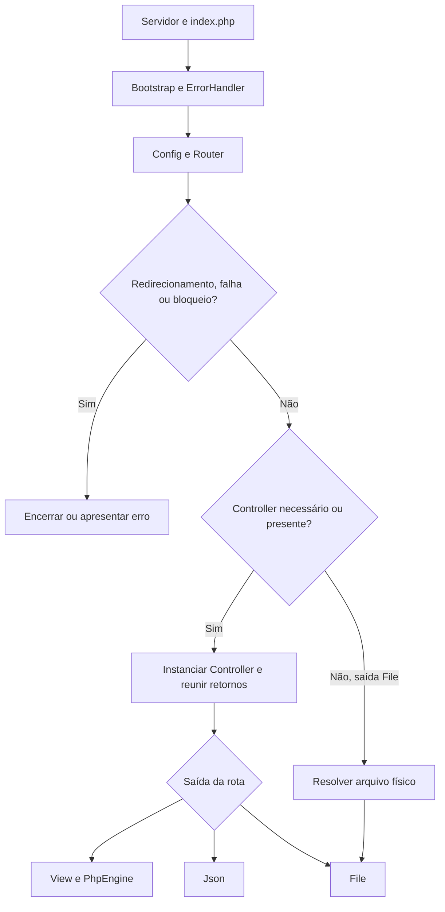

> **Aviso:** Este conteúdo foi gerado por IA e está sendo revisado e corrigido por um humano.

# Inicialização — de uma requisição ao framework

## A entrada concreta

O servidor deve encaminhar a requisição para `public/index.php`. O arquivo ativa `display_errors`, configura `error_reporting(E_ALL)` e inclui `galastri/bootstrap/bootstrap.php`.

Essas primeiras linhas acontecem antes do gerenciador de erros do framework. Um erro de configuração do PHP ou a ausência do próprio bootstrap não passa necessariamente pelo formato de resposta do Galastri. É por isso que um erro de servidor e uma exceção de controller precisam ser investigados em pontos diferentes.

## Um percurso com desvios reais

O diagrama resume o fluxo; a ordem exata de verificações está na referência de `Galastri`. Uma exceção pode interromper praticamente qualquer etapa depois de o ErrorHandler ser registrado.

## A primeira requisição do projeto

Na aplicação inicial, `routes.php` declara a raiz `/`, um título e `@main`. Os valores padrão escolhem a saída `view`, o template `/app/templates/template.php` e a pasta `/app/views`.

O Router resolve `app\controllers\Index` e `main`. A criação do objeto dispara o construtor final herdado de `Controller`, que chama o método resolvido e monta o array de resposta. `View` resolve a view e instancia `PhpEngine` como `$g`; o template pode incluir a view com `$g->include('view')`.

Para observar este percurso, compare a configuração com `app/controllers/Index.php`, `app/templates/template.php` e `app/views/Index/main.php`. Nenhuma conexão de banco é necessária para esse atendimento inicial.

## Request URI e query string

`REQUEST_URI` participa do roteamento, mas o Router remove a query string antes de dividir o caminho. `/clientes?pagina=2` e `/clientes?pagina=3` percorrem a mesma árvore de nós; os valores da consulta são entrada de dados, acessível por `HttpData`, por exemplo.

O servidor também participa dessa distinção: as regras de reescrita preservam a query string para a entrada PHP. Uma regra errada pode alterar o que chega ao Router antes de qualquer classe do framework executar.

## Perguntas de depuração

- A requisição chegou ao PHP ou o servidor respondeu antes?
- O autoload foi carregado?
- O ErrorHandler já tinha sido registrado quando a falha aconteceu?
- O Router resolveu uma rota válida?
- A classe de saída exige controller?
- A falha aconteceu ao produzir os dados ou ao renderizá-los?

Seguir essa ordem evita tentar corrigir uma view quando a causa real é um socket FPM indisponível.

## Onde conferir no código

- [`public/index.php`](https://github.com/andregalastri/galastri-framework-2/blob/55e91da329a50762a743f838c5899e60fc1e6764/public/index.php)
- [`galastri/bootstrap/bootstrap.php`](https://github.com/andregalastri/galastri-framework-2/blob/55e91da329a50762a743f838c5899e60fc1e6764/galastri/bootstrap/bootstrap.php)
- [`galastri/core/Galastri.php`](https://github.com/andregalastri/galastri-framework-2/blob/55e91da329a50762a743f838c5899e60fc1e6764/galastri/core/Galastri.php)
- [`app/config/routes.php`](https://github.com/andregalastri/galastri-framework-2/blob/55e91da329a50762a743f838c5899e60fc1e6764/app/config/routes.php)
- [`app/controllers/Index.php`](https://github.com/andregalastri/galastri-framework-2/blob/55e91da329a50762a743f838c5899e60fc1e6764/app/controllers/Index.php)

---

[Início](/andregalastri/galastri-framework-2/wiki/Home) · [Roteiro de estudo](/andregalastri/galastri-framework-2/wiki/Roteiro-de-estudo) · [Base desta edição](/andregalastri/galastri-framework-2/wiki/Base-desta-edicao)
